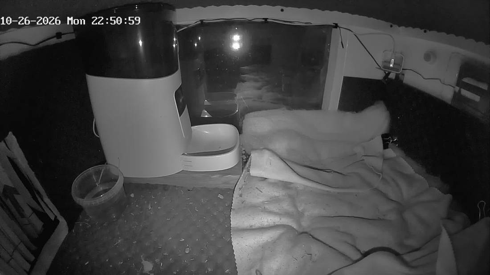

# camgrabber



*Так выглядит один снимок из архива: камера `pixel`, домик Пикселя.*

Раз в минуту сохраняет кадр с каждой камеры Frigate и хранит длинный архив (месяцы и годы),
потому что сами камеры и Frigate держат запись всего пару недель. Из архива делают timelapse
и смотрят, что было давно.

Один контейнер на Python (только Pillow), без cron, nginx и ffmpeg.

Минутные снимки хранятся полгода, дальше остаётся кадр раз в 5 минут. На админ-странице есть таймлайн
дня: водишь мышью по ленте и видишь, что происходило в этот момент.

## Камеры

Сейчас снимаются 8 камер с двух серверов Frigate:

| Папка архива | Сервер | Камера во Frigate | Что снимает (по названию) |
|---|---|---|---|
| `hpserver_car` | hpserver (Бутово) | `cam_eb5e43f0` («Машина») | машина |
| `hpserver_entrance` | hpserver (Бутово) | `cam_f0e66160` («Подъезд») | подъезд |
| `dachaserver_domik` | dachaserver (дача) | `Domik` | домик на даче |
| `dachaserver_saray` | dachaserver (дача) | `Saray` | сарай |
| `dachaserver_sosedi` | dachaserver (дача) | `Sosedi` | сторона соседей |
| `dachaserver_sosedi2` | dachaserver (дача) | `Sosedi2` | сторона соседей, вторая камера |
| `dachaserver_stolb` | dachaserver (дача) | `Stolb` | столб |
| `dachaserver_pixel` | dachaserver (дача) | `Pixel` | домик Пикселя |

Старые папки (`butovo_car`, `butovo_entrance`, `dacha_main`, `dacha_garage`, `dacha_neighbours`, `dacha_neighbours2`,
`dacha_north`, `dacha_cat`) слиты в новые: `car`, `entrance`, `domik`, `saray`, `sosedi`, `sosedi2`, `stolb`, `pixel`
соответственно, так что старые и новые снимки каждой камеры лежат в одной папке.

## Как работает

- **Камеры берутся из Frigate** (`/api/config`), список обновляется каждые 5 минут, отключённые камеры пропускаются.
  Папка камеры называется `<сервер>_<имя во Frigate в нижнем регистре>`, например `dachaserver_domik`.
  Имена можно переопределить через `aliases` в `servers.json`.
- **Кадр** берётся из go2rtc (`/api/frame.jpeg?src=<камера>_live`, затем `<камера>`), то есть в полном разрешении
  основного потока. Если go2rtc недоступен, берётся `latest.jpg` из Frigate (разрешение потока detect), а на
  админ-странице камера отмечена как «низкое».
- Все запросы с жёсткими таймаутами, одна повторная попытка. Если 15 минут нет ни одного успешного цикла,
  процесс завершается и Docker его перезапускает.
- Папки и файлы создаются от имени `OWNER_UID:OWNER_GID` с правами 775/664, запись через временный файл и rename.
  Сам процесс работает от root, поэтому права на папке ему не мешают.

Структура архива (та же, что у старой PHP-версии):

```
<TIMELAPSE_PATH>/<сервер>_<камера>/YYYY-MM-DD/YYYY-MM-DD_HH-MM-SS.jpg
```

## Настройка серверов

Настройки меняются на странице `/settings` (ссылка «Настройки» на главной):

- **Серверы Frigate**: добавить, удалить, поправить адреса. Кнопка «Проверить» показывает версию Frigate и список его
  камер (удобно для `aliases`).
- **Съёмка и хранение**, три поля:
  1. *Частота снимков, раз в N минут* (1-60). Кадры делаются в минуты суток, кратные N.
  2. *Хранить все снимки, дней* (D). 0 или пусто: ничего не удалять.
  3. *Потом оставлять снимок раз в M минут* (M кратно N). В днях старше D остаются только кадры, время которых
     (в минутах от полуночи) делится на M, остальные удаляются; оставшиеся хранятся бессрочно.

  Страница сразу показывает итоговую фразу. Чистка помнит в файле `.thinned`, до какой частоты день уже прорежен, и
  повторно прореживает его, только если M стало больше.

Изменения применяются сразу, без перезапуска, и сохраняются в `state/servers.json`.

[servers.json](servers.json) в репозитории это начальные настройки: он читается, пока файла `state/servers.json`
ещё нет (пароли в нём не хранятся):

```json
{
  "servers": [
    {
      "name": "hpserver",
      "frigate": "http://172.17.0.1:5000",
      "go2rtc": "http://172.17.0.1:1984",
      "aliases": {"cam_eb5e43f0": "car", "cam_f0e66160": "entrance"}
    }
  ]
}
```

| Поле | Значение |
|---|---|
| `name` | префикс папок камер этого сервера |
| `frigate` | адрес API Frigate (порт 5000 без авторизации) |
| `go2rtc` | адрес go2rtc API (порт 1984); можно пустым, тогда всегда `latest.jpg` |
| `aliases` | необязательно: имя камеры во Frigate -> имя папки |

Если нужно вернуться к настройкам из репозитория, удалите `state/servers.json` и перезапустите контейнер.
Имя сервера задаёт префикс папок архива, у работающего сервера его менять не стоит.

Остальные параметры (файл `.env` рядом с `docker-compose.yml`, образец в [.env.example](.env.example)):

| Переменная | По умолчанию | Смысл |
|---|---|---|
| `TIMELAPSE_PATH` | `/mnt/nas/timelapse` | папка архива на хосте |
| `BIND_IP`, `HOST_PORT` | `127.0.0.1`, `8099` | где открыть админ-страницу |
| `CLEAN_DRY_RUN` | `1` | `1` только считать, `0` реально удалять |

Параметры в `environment` в `docker-compose.yml`: `KEEP_FULL_DAYS` (начальное значение D, сейчас 183; потом D, N и M меняют на странице настроек),
`CLEAN_HOUR` (час ночной чистки), `CLEAN_LOOKBACK_DAYS`, `OWNER_UID`/`OWNER_GID`.

## Запуск

```bash
cp .env.example .env     # поправить пути и адрес
docker compose up -d --build
```

## Чистка

Каждую ночь в `CLEAN_HOUR` в днях старше D остаются только снимки раз в M минут (по умолчанию D=183, M=5),
остальные удаляются. Обработанный день помечается файлом `.thinned`. Проверить без удаления:

```bash
docker exec -e CLEAN_DRY_RUN=1 camgrabber python /app/grabber.py clean
```

## Админ-страница (порт 8099)

- `/` список камер: миниатюра, время последнего снимка (красным, если старше 3 минут), режим кадра, число дней,
  размер, ошибка; занятое место на диске и состояние чистки. Размеры считаются медленным проходом с паузами раз
  в сутки, чтобы не нагружать диск.
- `/cam/<папка>` страница камеры: таймлайн дня, по наведению мыши показывается кадр, стрелки переключают дни
  (также ←/→, PageUp/PageDown). День и время хранятся в адресе (`?d=2026-01-04&t=23-59-01`).
- Для плавности для каждого дня сервер собирает один файл с превью (`<TIMELAPSE_PATH>/.previews/<папка>/<дата>.bin`),
  при первом открытии дня (прогресс виден на странице; сборка отменяется, если страницу закрыли) и ночью для вчерашнего дня.
- `/api/status` состояние в JSON.

Страница не защищена паролем: кроме просмотра она позволяет менять адреса серверов Frigate (только запросами JSON
с этой же страницы). Не открывайте её наружу, привяжите к адресу локальной сети (`BIND_IP`).

## Заполнение пропусков из записей Frigate

Если съёмка простояла, кадры раз в 5 минут можно достать из записей Frigate (они хранятся только несколько дней):

```bash
docker exec camgrabber python /app/grabber.py backfill --dry   # сколько кадров не хватает
docker exec -d camgrabber python /app/grabber.py backfill
```

Повторный запуск безопасен, существующие кадры пропускаются.

## Samba

Если папка архива отдаётся по SMB, в шаре `timelapse` задайте `force user`/`force group` на того же пользователя,
что и `OWNER_UID`, и не включайте флаг `-p` (он при каждом старте делает `chown -R` по всем шарам).
