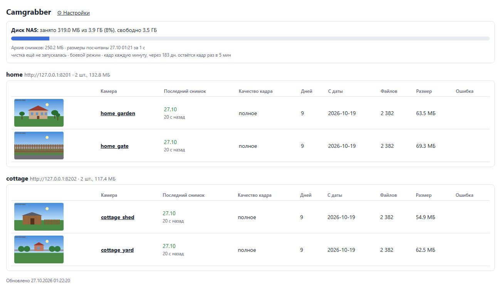
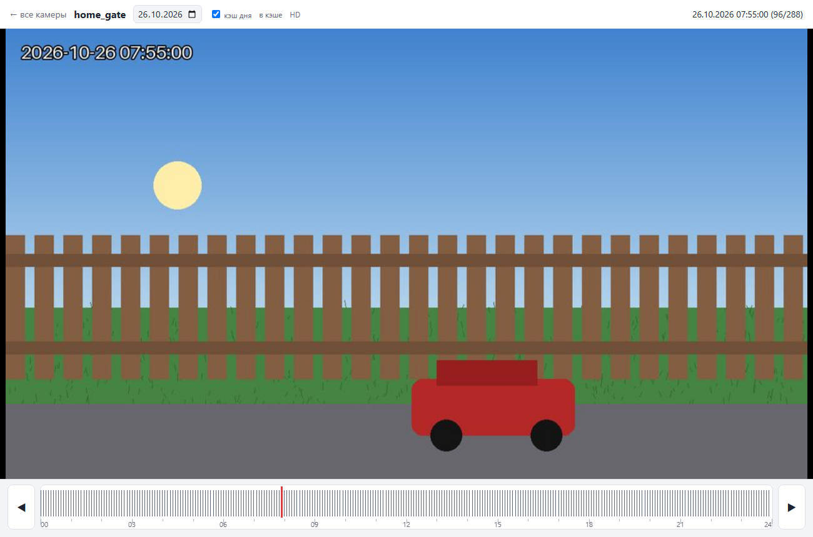
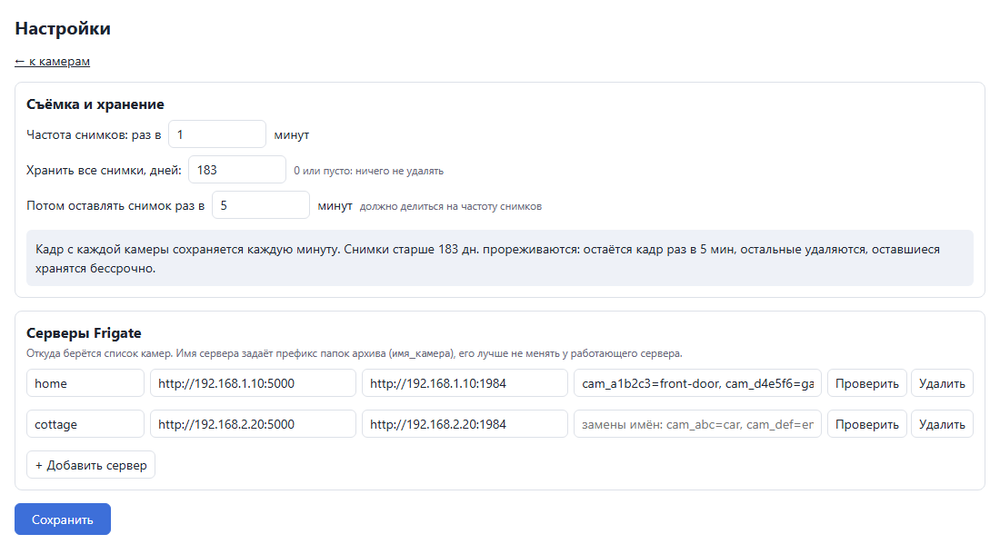

# camgrabber



**Долгий покадровый архив камер видеонаблюдения.** Раз в минуту (или как настроите) camgrabber сохраняет кадр
с каждой камеры [Frigate](https://frigate.video) и хранит эти кадры месяцами и годами.

## Зачем это нужно

Видеорегистратор (Frigate, NVR или сама камера) хранит запись всего несколько дней или недель, потом она стирается.
А вопрос «что происходило на участке два месяца назад?» возникает позже. Покадровый архив занимает в десятки раз
меньше места, чем видео, и позволяет:

- **Мгновенно найти нужный момент.** Открываете камеру, водите мышью по ленте дня и сразу видите, что происходило:
  когда приехала машина, когда появился человек, во сколько стемнело. Нашли время, и уже в видеорегистраторе
  смотрите запись этой конкретной минуты.
- **Смотреть прошлое, даже если в архиве Frigate записей уже не осталось.** Видео давно удалено, а кадры
  остаются.
- **Делать timelapse** из накопленных снимков.

## Возможности

- Камеры берутся из Frigate автоматически, поддерживается несколько серверов Frigate (дом, дача, офис).
- Кадры в полном разрешении основного потока камеры (через go2rtc), запасной вариант: снимок из Frigate.
- Частота съёмки настраивается: от раза в минуту до раза в час.
- Ступенчатое хранение: все кадры за последние N дней, дальше остаётся кадр раз в M минут. Диск не растёт
  бесконечно, а общая картина дня сохраняется.
- Админ-страница: состояние камер, последний снимок, занятое место, настройки.
- Страница камеры с лентой дня: наводите курсор и сразу видите кадр, стрелки переключают дни.
- Заполнение пропусков из записей Frigate, если съёмка простаивала.
- Один контейнер на Python, без базы данных.

## Как выглядит

### Главная страница

Камеры сгруппированы по серверам Frigate: миниатюра, время последнего снимка, качество кадра, число дней в архиве,
размер. Вверху занятое место на диске и текущие правила хранения.

### Просмотр камеры

Лента внизу показывает все снимки дня палочками. Ведёте курсор над лентой и видите, что происходило в этот момент
(на скриншоте 7:55, проезжает машина). Стрелки по бокам переключают день, адрес страницы хранит день и время.
Все кадры дня подгружаются в браузер одним файлом, поэтому лента работает без задержек.



### Настройки

Частота съёмки, срок хранения всех кадров и частота кадров в «долгом» архиве, а также список серверов Frigate
(добавить, удалить, проверить соединение). Итоговая фраза под полями объясняет, что будет с архивом.



*На скриншотах демо-данные: искусственные кадры и вымышленные серверы.*

## Быстрый старт

Нужны Docker и Frigate (проверено на 0.17) с доступным API на порту 5000 и go2rtc на порту 1984.

```bash
git clone https://github.com/kisilmike/camgrabber.git
cd camgrabber
cp .env.example .env      # укажите папку архива и адрес для админ-страницы
docker compose up -d --build
```

Откройте админ-страницу (по умолчанию `http://127.0.0.1:8099`), перейдите в «Настройки» и укажите адреса своих
серверов Frigate. Через минуту появятся первые снимки.

## Настройки

Всё меняется на странице «Настройки» и применяется сразу, без перезапуска. Сохраняется в `state/servers.json`.
Файл [servers.json](servers.json) в репозитории это только пример начальных настроек.

**Съёмка и хранение**, три поля:

1. *Частота снимков, раз в N минут* (1-60). Кадры делаются в минуты суток, кратные N.
2. *Хранить все снимки, дней* (D). 0 или пусто: ничего не удалять.
3. *Потом оставлять снимок раз в M минут* (M кратно N). В днях старше D остаются только кадры, время которых
   (в минутах от полуночи) делится на M, остальные удаляются, оставшиеся хранятся бессрочно.

**Серверы Frigate:**

| Поле | Значение |
|---|---|
| имя | префикс папок камер этого сервера (`home` даёт `home_garden`) |
| Frigate | адрес API Frigate (порт 5000 без авторизации) |
| go2rtc | адрес go2rtc API (порт 1984), можно пустым: тогда всегда снимок из Frigate |
| замены имён | необязательно: `имя камеры во Frigate=имя папки` |

Параметры в `.env` (образец в [.env.example](.env.example)):

| Переменная | По умолчанию | Смысл |
|---|---|---|
| `TIMELAPSE_PATH` | `/mnt/nas/timelapse` | папка архива на хосте |
| `BIND_IP`, `HOST_PORT` | `127.0.0.1`, `8099` | где открыть админ-страницу |
| `CLEAN_DRY_RUN` | `1` | `1` чистка только считает, что удалила бы; `0` реально удаляет |

В `environment` в `docker-compose.yml` задаются `KEEP_FULL_DAYS` (начальное значение D, дальше меняется на странице
настроек), `CLEAN_HOUR` (час ночной чистки), `OWNER_UID`/`OWNER_GID` (владелец файлов архива).

## Как это работает

- Список камер берётся из Frigate (`/api/config`) и обновляется каждые 5 минут, отключённые камеры пропускаются.
- Кадр берётся из go2rtc (`/api/frame.jpeg`), то есть в полном разрешении основного потока. Если go2rtc недоступен,
  берётся `latest.jpg` из Frigate (меньшее разрешение), на главной такая камера помечается как «низкое».
- Все запросы с жёсткими таймаутами и одной повторной попыткой. Если 15 минут нет ни одного успешного цикла,
  процесс завершается и Docker его перезапускает.
- Файлы пишутся через временный файл и rename, права 775/664, владелец задаётся `OWNER_UID:OWNER_GID`.

Структура архива:

```
<TIMELAPSE_PATH>/<сервер>_<камера>/YYYY-MM-DD/YYYY-MM-DD_HH-MM-SS.jpg
```

## Чистка

Каждую ночь в `CLEAN_HOUR` в днях старше D остаются только снимки раз в M минут, остальные удаляются. Обработанный
день помечается файлом `.thinned` с частотой, до которой он прорежен, поэтому смена M безопасна: день обрабатывается
повторно, только если M стало больше. Проверить без удаления:

```bash
docker exec -e CLEAN_DRY_RUN=1 camgrabber python /app/grabber.py clean
```

## Просмотр камеры и предпросмотр

На странице `/cam/<папка>` для каждого дня сервер собирает один файл с уменьшенными кадрами
(`<TIMELAPSE_PATH>/.previews/<папка>/<дата>.bin`) при первом открытии дня, а вчерашний день ночью. Прогресс виден
на странице, а сборка отменяется, если страницу закрыли. Адрес страницы хранит день и время
(`?d=2026-10-26&t=07-55-00`), ссылкой можно поделиться.

`/api/status` отдаёт состояние в JSON.

## Заполнение пропусков из записей Frigate

Если съёмка простояла, кадры раз в M минут можно достать из записей Frigate (пока они там ещё хранятся):

```bash
docker exec camgrabber python /app/grabber.py backfill --dry   # сколько кадров не хватает
docker exec -d camgrabber python /app/grabber.py backfill
```

Повторный запуск безопасен, существующие кадры пропускаются.

## Безопасность

Админ-страница не защищена паролем: кроме просмотра она позволяет менять адреса серверов Frigate (только запросами
JSON с этой же страницы). Не открывайте её в интернет, привяжите к адресу локальной сети (`BIND_IP`) или поставьте
за обратный прокси с авторизацией.

Если папка архива отдаётся по SMB (samba), задайте для шары `force user` и `force group` на того же пользователя, что
и `OWNER_UID`: тогда права не зависят от того, кто зашёл по сети.
